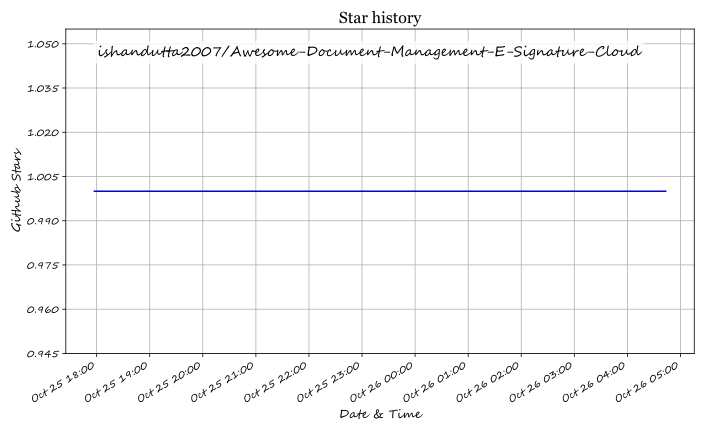

# Awesome-Document-Management-E-Signature-Cloud

# Awesome-Document-Management-E-Signature-Cloud

Copy-Item README.md README.md.bak -Force
# Manual step: replace SaaS and Open-Source sections with content above
git add README.md
git commit -m "docs: add e-signature pricing data (DocuSign, PandaDoc, Dropbox Sign, SignNow free tiers) and open-source Trilli"
git push

## ⭐ Star History

<a href="https://star-history.com/#ishandutta2007/Awesome-Document-Management-E-Signature-Cloud&Timeline" align="center">
  <picture>
    <source media="(prefers-color-scheme: dark)" srcset="assets/ishandutta2007_Awesome-Document-Management-E-Signature-Cloud_growth.svg">
    
  </picture>
</a>
