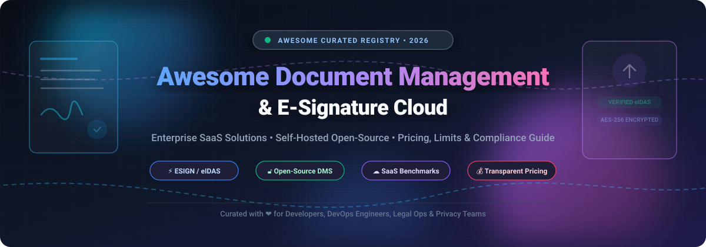

# Awesome Document Management & E-Signature Cloud

  

  
  
  
  
  
  

> 📚 A curated showcase of top-tier Document Management Systems (DMS) 🗄️, Electronic Signature (e-Sign) platforms ✍️, Enterprise Content Management (ECM) tools 🏛️, and cloud document automation pipelines ☁️.

Looking for battle-tested alternatives to DocuSign 🖊️, Adobe Acrobat Sign 📑, or PandaDoc 🐼? Whether you require sovereign, self-hosted open-source software 🔓 with OCR scanning and granular permissions or enterprise-ready cloud SaaS solutions 💼, this directory provides transparent pricing, strict free tier allowances, market dynamics, and star ratings ⭐.

---

## 📑 Contents

- [🌐 Sector Overview & Market Dynamics](#-sector-overview--market-dynamics)
- [💼 Proprietary & SaaS Solutions](#-proprietary--saas-solutions)
- [🔓 Open-Source Solutions](#-open-source-solutions)
- [🔍 Key Features to Consider](#-key-features-to-consider)
- [📈 Star History](#-star-history)
- [💖 Support & Sponsorship](#-support--sponsorship)
- [🤝 Contributing](#-contributing)

---

## 🌐 Sector Overview & Market Dynamics

📊 The global digital signature and document management market is currently valued at approximately **$20B–$27B** (with the pure-play e-signature sector representing ~$13B–$17B and expanding at an aggressive CAGR of >25% 🚀, while cloud document management software represents ~$8B–$10B growing at ~12–15% CAGR 📈).

🏛️ The sector is **moderately concentrated at the Tier-1 enterprise tier**, where dominant titans (DocuSign, Adobe, Microsoft, Dropbox) control over 40% of global enterprise contract volume. Simultaneously, it remains **substantially fragmented across SMB, regional, and niche compliance verticals** 🌍 due to localized legal frameworks (e.g., EU eIDAS Qualified Electronic Signatures 🇪🇺, HIPAA 🏥, SOC 2 🛡️) and rapidly accelerating demand for self-hosted, sovereign open-source architectures.

---

## 💼 Proprietary & SaaS Solutions

*🏢 Leading commercial SaaS platforms sorted by company scale (market capitalization / valuation / annual revenue in descending order).*

| Provider 🏢 | Starting Paid Price 💳 | Free Tier / Free Trial Limits 🎁 | Company Scale (Valuation / Revenue) 📊 | Key Strengths & Compliance 🛡️ |
| :--- | :--- | :--- | :--- | :--- |
| **[Adobe Acrobat Sign](https://www.adobe.com/sign.html)** 🔴 | **$14.99/mo** (Acrobat Standard, annual commitment) | **No permanent free sending plan**; free Adobe Acrobat Reader allows unlimited personal self-signing; **7-day free trial** of Acrobat Pro with full e-signing and template tools | **~$200B+ Market Cap** (Adobe Inc., NASDAQ: ADBE; Document Cloud segment ARR >$3.3B) | Global compliance (eIDAS, ESIGN, UETA, HIPAA), deep integration with Microsoft 365, PDF standard leadership 🌟 |
| **[DocuSign](https://www.docusign.com/)** 🟡 | **$10.00/mo** (Personal plan, billed annually at $120/yr, or $15/mo billed monthly) | **Lifetime cap of 3 signature requests** total on Free Account (max 5 recipients/envelope); **30-day free trial** of Business Pro features (capped at 5 envelopes/day) | **~$15B–$18B Market Cap** (NASDAQ: DOCU; ~$2.98B FY2025 Revenue) | Gold standard for enterprise agreement lifecycle management, extensive API ecosystem, 400+ turnkey integrations 🔗 |
| **[Dropbox Sign](https://sign.dropbox.com/)** *(formerly HelloSign)* 🔵 | **$15.00/mo** (Essentials plan, billed annually at $180/yr, or $20/mo billed monthly) | **3 signature requests per 30-day rolling window** (unlimited self-signing on free tier); **30-day free trial** on paid plans with templates and audit trails | **~$8B Market Cap** (Parent: Dropbox Inc., NASDAQ: DBX; ~$2.52B corporate revenue; acquired for $230M) | Seamless cloud drive synchronization, developer-friendly REST API, clean minimalist UX ⚡ |
| **[signNow](https://www.signnow.com/)** *(airSlate)* 🟠 | **$8.00/user/mo** (Business plan, billed annually at $96/yr, or $20/user/mo billed monthly) | **No permanent free sending plan**; provides a **7-day free trial** with full access to invites and template creation (no credit card required) | **$1.25B Valuation** (Parent: airSlate Series C unicorn; >$100M ARR) | Cost-effective multi-user team licensing, no-code document generation, complex approval routing 🔀 |
| **[PandaDoc](https://www.pandadoc.com/)** 🟢 | **$19.00/user/mo** (Starter plan, billed annually at $228/yr, or $35/user/mo billed monthly) | **5 documents per month** forever free (*Free eSign Plan*, max 2 recipients/doc); **14-day free trial** of Business tier (no credit card required) | **$1.0B Valuation** (Series C unicorn; >$100M ARR) | Interactive proposals with integrated CPQ, native Stripe/PayPal payment collection, media-rich document builder 🎨 |

---

## 🔓 Open-Source Solutions

*💻 Self-hosted, transparent, and privacy-first document management systems and e-signing platforms sorted by GitHub star counts (descending).*

| Project 📦 | GitHub Stars ⭐ | Description 📝 | Core Tech Stack 🛠️ |
| :--- | :---: | :--- | :--- |
| **[Stirling-PDF](https://github.com/Stirling-Tools/Stirling-PDF)** |  | Powerful, locally hosted web application that lets you edit, sign, convert, split, merge, and secure PDFs without data leaving your server. | Java ☕, Spring Boot 🍃, Docker 🐳 |
| **[Paperless-ngx](https://github.com/paperless-ngx/paperless-ngx)** |  | Community-supported supercharged document management system designed to scan, index, tag, and archive physical and digital paperwork with OCR. | Python 🐍, Django 🎸, Angular 🅰️, Tesseract 👁️ |
| **[Nextcloud Server](https://github.com/nextcloud/server)** |  | Self-hosted productivity and document collaboration suite featuring comprehensive file management, workflow automation, and LibreOffice/OnlyOffice document editing. | PHP 🐘, JavaScript ⚡, Docker 🐳 |
| **[Documenso](https://github.com/documenso/documenso)** |  | The premier open-source DocuSign alternative. Built for transparency, embeddable signing experiences, cryptographic verification, and modern agreement infrastructure. | TypeScript 🔷, Next.js ⚛️, Prisma 💎, PostgreSQL 🐘 |
| **[OpenSign](https://github.com/OpenSignLabs/OpenSign)** |  | Modern, free, and open-source electronic signature platform with PDF form generation, signing pads, multi-signers, and full email OTP verification. | Node.js 🟩, React ⚛️, Express 🚂, MongoDB 🍃 |
| **[Papermerge](https://github.com/ciur/papermerge)** |  | Open-source document management system (DMS) primarily focused on archiving and organizing scanned digital documents and invoices with OCR. | Python 🐍, Django 🎸, Celery 🌿 |
| **[Teedy (formerly Docs)](https://github.com/sismics/docs)** |  | Lightweight, full-featured enterprise document management system supporting full-text OCR search, metadata extraction, and multi-user permissions. | Java ☕, Vue.js 🖖, Docker 🐳 |
| **[Paperwork](https://github.com/openpaperwork/paperwork)** |  | Personal document manager designed to make scanning, OCR indexing, searching, and organizing documents effortless with a local-first philosophy. | Python 🐍, GTK 🖼️, Tesseract OCR 🔍 |
| **[Digital Signature Service (DSS)](https://github.com/esig/dss)** |  | Official European Commission reference implementation for creating, extending, and validating advanced and qualified electronic signatures (eIDAS / AdES). | Java ☕, Spring 🍃, Cryptographic standards 🔐 |
| **[Mayan EDMS](https://github.com/mayan-edms/mayan-edms)** |  | Free and open-source electronic vault and document management system featuring version control, workflow orchestration, OCR, and granular cryptographic signatures. | Python 🐍, Django 🎸, Celery 🌿, Redis 🔴 |

---

## 🔍 Key Features to Consider

When choosing between commercial SaaS and open-source solutions:

1. **⚖️ Legal Validity & Admissibility:** Ensure compliance with statutory frameworks such as U.S. ESIGN/UETA, EU eIDAS (SES, AES, QES), and localized digital signature laws.
2. **🛡️ Audit Trails & Tamper Evidence:** Look for automated SHA-256 cryptographic hashing, IP logging, certificate-backed PKI timestamping, and court-ready audit certificates.
3. **🔎 OCR & Semantic Retrieval:** Evaluate whether the platform supports automated full-text OCR indexing and multi-format parsing (PDF, DOCX, scanned images, TIFF).
4. **🔐 Data Sovereignty & Self-Hosting:** For sensitive healthcare (HIPAA) or financial (FINRA) sectors, evaluate whether self-hosted Docker containers are required to keep confidential contracts within internal networks.

---

##  Star History

---

## 💖 Support & Sponsorship

Thank you so much for exploring and using this curated list! 🌟 If you find this repository valuable:
- ⭐ **Star this repository** to help others discover it!
- 🍴 **Fork it** to customize your own software evaluation stacks!
- 📢 **Share it** with fellow developers, DevOps teams, legal technologists, and open-source enthusiasts!

☕ If you would like to buy me a coffee or support ongoing maintenance and research across open-source ecosystems, consider sponsoring via the dashboard below:

---

## 🤝 Contributing

Contributions, software recommendations, and updates are warmly welcomed! 🎉 Please check our contribution guidelines or submit a pull request with new tools that fit our schema.
